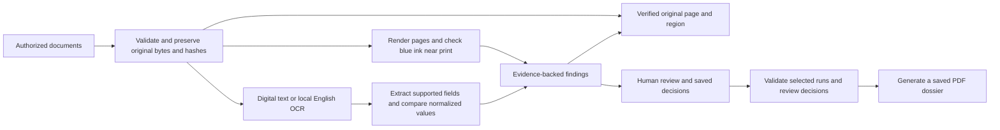

# Prototype architecture

The PS2 prototype ingests and verifies original files, reads supported layouts, checks fields and page appearance, records review decisions, and exports PDF dossiers.

## Processing flow

## Shared records

- **InvestigationCase:** One related set of documents, extracted fields, findings, and processing history.
- **Document:** A stable document ID, original filename, optional type, page count, and SHA-256 digest. The digest identifies the file that was actually examined.
- **ExtractedField:** A named value, optional confidence, and a source reference. OCR output is an observation, not verified truth.
- **EvidenceRef:** A document ID and a region on one page. It may also carry the observed text.
- **Finding:** An observation, explanation, confidence, category, review state, and one or more evidence references. Findings are leads for review, not automatic fraud decisions.
- **AuditEvent:** A time-stamped record of processing or review activity.

The framework-independent contracts are in `docforensics/models.py`. OCR, image analysis, interface, and report code should use these records rather than inventing incompatible formats.

## Source location convention

Regions use **1-based page numbers** and normalized page coordinates from 0 to 1. The origin is the top-left corner: `x1, y1` is the upper-left and `x2, y2` is the lower-right. This permits the same evidence reference to be drawn on a thumbnail, full-resolution image, or PDF page. An ingestion adapter must convert pixel or PDF coordinates into this format before creating a field or finding. `SourceRegion.from_pixels(...)` handles image or OCR bounding boxes.

Case validation rejects evidence that names an absent document or a page beyond the known page count. Findings cannot exist without evidence.

## Local demonstration data

The [ingestion layer](ingestion.md) accepts a packet of PDFs, PNGs, and JPEGs into a new saved case. `docforensics/ingestion.py` preserves original bytes, rejects unsupported or unreadable files individually, deduplicates identical content within the packet, and assigns stable document and page IDs. Its `CaseStore.as_case(...)` returns the shared `InvestigationCase` after source verification. JSON case records support mixed file formats; the existing A01 manifest remains the PDF-only foundation example. File-format identification does not classify the document's business type or extract text.

The provided 15 scanned PDFs are in `../output/pdf/ocr_assignment_dataset/pdfs` relative to this repository, outside Git. A separate `ground_truth.csv` labels their unmodified and altered variants. Use labels **only to evaluate the system after it produces findings**; the running detection pipeline must not read them. Keep source documents and the answer key out of the public repository until their sharing rights are confirmed.

The supplied five groups contain variants of one document per group. The contextual evaluation also uses controlled Student Registration and Enrollment Confirmation forms to test mismatches across related document types.

The [local case manifest](local-manifest.md) records file identities, page counts, and hashes for A01 without copying source PDFs or reading evaluation labels.

The [evidence tracing guide](evidence-tracing.md) describes the separate single-PDF manual tool. The multi-document upload screen automatically runs a limited visual check after saving a case. The [reviewer workspace](reviewer.md) combines text extraction, contextual checks, visual findings, and source inspection across the saved packet.

## Processing services and storage

- [Text extraction](ocr.md) uses PyMuPDF for digital text and the local English Tesseract model for scanned pages. Supported layouts supply typed fields and source rectangles.
- [Contextual comparison](contextual.md) uses deterministic normalization and compares related documents after reviewer confirmation.
- [Visual inspection](visual.md) uses a color and proximity check on rendered pages. Findings include verified source locations and crops.
- The application saves original copies, processing snapshots, and review events in an external local directory. [Dossier export](dossier.md) verifies source fingerprints and uses ReportLab to render the selected run data and decisions as a new PDF.

## Processing contracts

`docforensics/processing.py` defines step requests, outputs, statuses, errors, and warnings. Its practice coordinator validates adapter output and records step events. The reviewer workspace calls the real feature services through local endpoints. The [processing contract guide](processing-contracts.md) describes the practice flow.

## Verification

From the repository root, install `requirements-dev.txt`, then run `python -m unittest discover -s tests -v`. The suite covers foundation contracts, local ingestion, extraction, contextual and visual findings, and saved human review. See the [setup guide](setup.md) for dependencies and commands.
