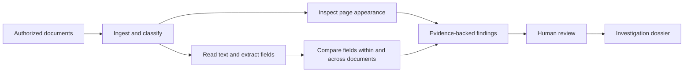

# Foundation architecture

This document records the shared design for the PS2 prototype. It describes the intended pipeline; OCR, visual analysis, review screens, and dossier generation are still separate work items.

## Processing flow

## Shared records

- **InvestigationCase:** One related set of documents, extracted fields, findings, and processing history.
- **Document:** A stable document ID, original filename, optional type, page count, and SHA-256 digest. The digest identifies the file that was actually examined.
- **ExtractedField:** A named value, optional confidence, and a source reference. OCR output is an observation, not verified truth.
- **EvidenceRef:** A document ID and a region on one page. It may also carry the observed text.
- **Finding:** An observation, explanation, confidence, category, review state, and one or more evidence references. Findings are leads for review, not automatic fraud decisions.
- **AuditEvent:** A time-stamped record of processing or review activity.

The framework-independent contracts are in `docforensics/models.py`. OCR, image analysis, interface, and report code should use these records rather than inventing incompatible formats.

## Source location convention

Regions use **1-based page numbers** and normalized page coordinates from 0 to 1. The origin is the top-left corner: `x1, y1` is the upper-left and `x2, y2` is the lower-right. This permits the same evidence reference to be drawn on a thumbnail, full-resolution image, or PDF page. An ingestion adapter must convert pixel or PDF coordinates into this format before creating a field or finding. `SourceRegion.from_pixels(...)` handles image or OCR bounding boxes.

Case validation rejects evidence that names an absent document or a page beyond the known page count. Findings cannot exist without evidence.

## Local demonstration data

The [ingestion layer](ingestion.md) accepts a packet of PDFs, PNGs, and JPEGs into a new saved case. `docforensics/ingestion.py` preserves original bytes, rejects unsupported or unreadable files individually, deduplicates identical content within the packet, and assigns stable document and page IDs. Its `CaseStore.as_case(...)` returns the shared `InvestigationCase` after source verification. JSON case records support mixed file formats; the existing A01 manifest remains the PDF-only foundation example. File-format identification does not classify the document's business type or extract text.

The provided 15 scanned PDFs are in `../output/pdf/ocr_assignment_dataset/pdfs` relative to this repository, outside Git. A separate `ground_truth.csv` labels their unmodified and altered variants. Use labels **only to evaluate the system after it produces findings**; the running detection pipeline must not read them. Keep source documents and the answer key out of the public repository until their sharing rights are confirmed.

Begin development with one three-document group, then test the same workflow on the remaining groups. The five groups contain variants of a single document each, so a later demonstration should also include related document types if cross-document contextual reasoning needs stronger evidence.

The [local case manifest](local-manifest.md) records file identities, page counts, and hashes for A01 without copying source PDFs or reading evaluation labels.

The [evidence tracing guide](evidence-tracing.md) describes both the fixed example and the local PDF upload screen. `docforensics/upload_app.py` serves a file picker, page preview, and manual region selection on the loopback interface. Each uploaded PDF becomes a separate verified manual case outside Git; the screen creates evidence bundles using the same tracing code and shared source coordinates. This is a partial interface for foundation verification; OCR, automatic findings, multi-document review, and reporting remain later work.

## Later implementation choices

- Select OCR, document rendering, storage, and interface implementations in the respective feature branches.
- Persist the shared review decisions and expose them in the review interface and dossier.
- Document unsupported formats and uncertain results rather than implying a complete forensic conclusion.

## Processing contracts

`docforensics/processing.py` defines the step requests, accepted outputs, statuses, errors, warnings, and review decisions. A synchronous coordinator validates adapter output and records audit events while keeping failures local to their affected inputs. The [processing contract guide](processing-contracts.md) contains the full rules and practice commands. Adapters for OCR, visual checks, contextual analysis, review screens, and report generation will be supplied by their feature branches.

## Foundation check

From the repository root, install `requirements-dev.txt`, then run `python -m unittest discover -s tests -v` to validate the shared models, manifest integrity, processing contracts, manual evidence tracing, and local upload endpoints. The checks do not implement actual OCR or automated alteration detection.
